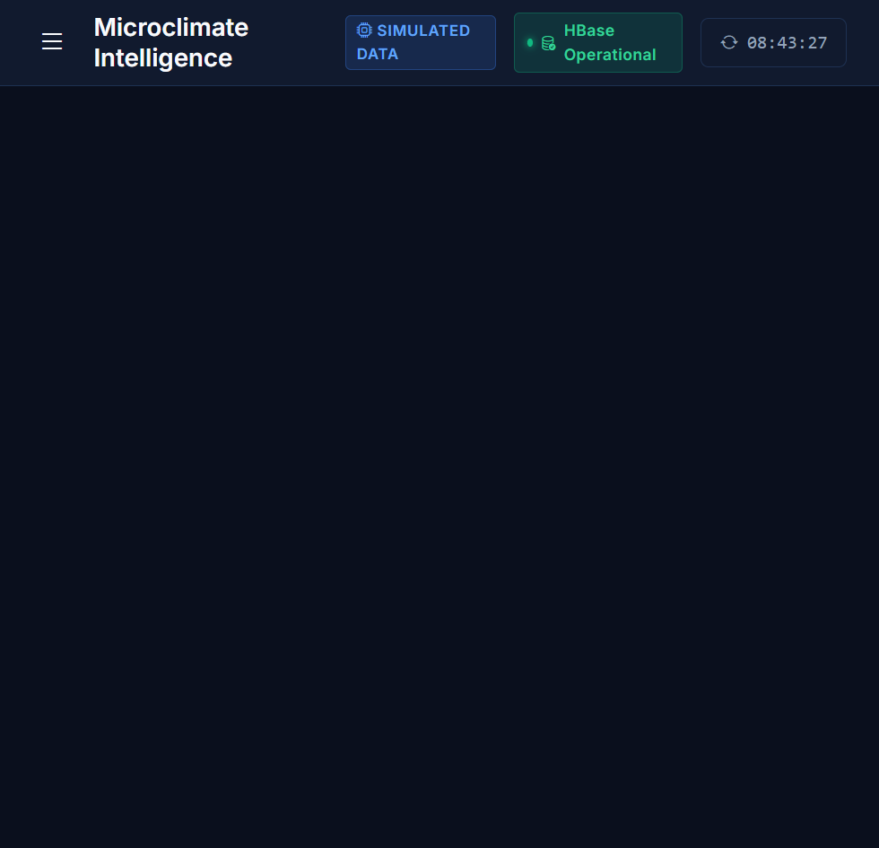
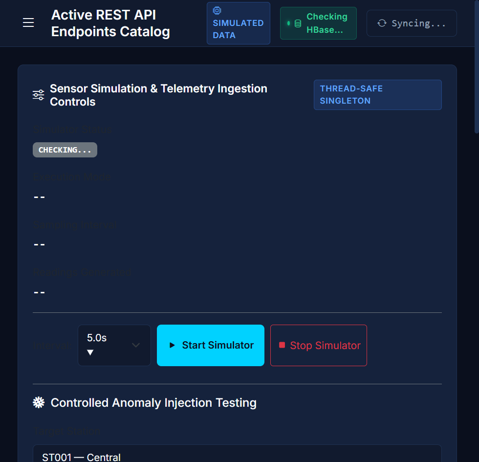
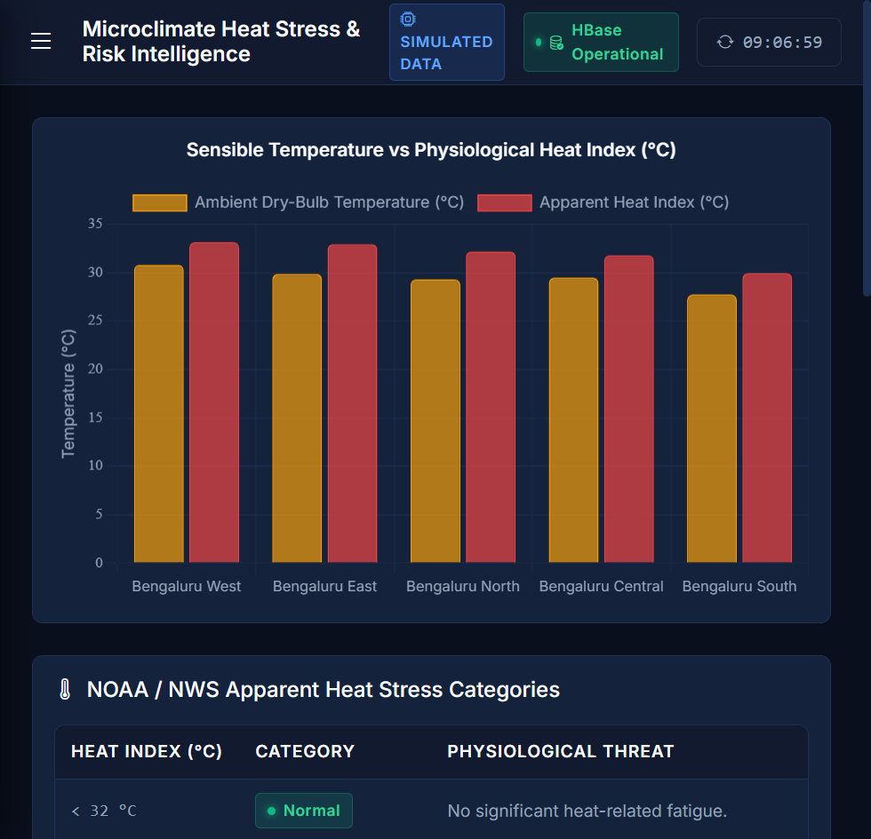

# Urban Microclimate & Heat-Risk Intelligence System using Apache HBase

[-red.svg)](https://hbase.apache.org/)
[](https://www.python.org/)
[](https://flask.palletsprojects.com/)
[]()
[]()

An enterprise-grade Big Data IoT streaming and urban heat-stress intelligence platform built on **Apache HBase 2.6.7 (Hadoop 3)** and **Python Flask**. The system continuously ingests high-frequency microclimate sensor observations across the Bengaluru metropolitan region, calculates physiological heat stress using the **National Weather Service (NWS) Steadman/Rothfusz Heat Index algorithm**, tracks particulate pollution against **Central Pollution Control Board (CPCB) India concentration breakpoints**, detects real-time environmental anomalies, and serves interactive dashboards and low-latency REST APIs.

---

## Table of Contents
1. [Problem Statement & Objectives](#problem-statement--objectives)
2. [End-to-End System Architecture](#end-to-end-system-architecture)
3. [Apache HBase Schema Design](#apache-hbase-schema-design)
4. [Scientific Methodology & Disclosures](#scientific-methodology--disclosures)
5. [Interactive Command-Center Dashboard](#interactive-command-center-dashboard)
6. [Prerequisites & Installation](#prerequisites--installation)
7. [Quick Start Guide](#quick-start-guide)
8. [REST API Reference & Examples](#rest-api-reference--examples)
9. [Automated Testing Suite](#automated-testing-suite)
10. [College Project Demonstration Script](#college-project-demonstration-script)
11. [Troubleshooting & FAQ](#troubleshooting--faq)
12. [Scientific Disclosures & Limitations](#scientific-disclosures--limitations)
13. [Academic Evaluation & Research Documentation](#academic-evaluation--research-documentation)

---

## Problem Statement & Objectives

Rapid urbanization, high vehicular density, and replacement of natural green canopies with asphalt and concrete surfaces cause localized **Urban Heat Islands (UHI)** and severe particulate matter concentration. Municipal authorities and smart-city operators require:
- **Scalable Big Data Persistence:** Ability to handle high-velocity time-series sensor ingestion without relational database bottlenecks.
- **Biometeorological Risk Assessment:** Real-time translation of ambient dry-bulb temperature and relative humidity into physiological thermal stress indices (apparent temperature).
- **Early Warning & Threshold Alerts:** Automated rule-based detection for extreme heatwaves, particulate spikes (PM2.5 / PM10), and hardware sensor dropouts.
- **Low-Latency Operational Visibility:** Responsive geospatial and analytical web dashboard presenting citywide risk rankings and multi-day partition queries.

---

## End-to-End System Architecture

```
┌────────────────────────────────────────────────────────────────────────┐
│             VIRTUAL SENSOR GENERATOR (ST001 - ST005)                   │
│   Diurnal Cycle + AR(1) Stochastic Drift + Controlled Anomaly Engine    │
└───────────────────────────────────┬────────────────────────────────────┘
                                    │ Generates timestamped readings
                                    ▼
┌────────────────────────────────────────────────────────────────────────┐
│                      ANOMALY DETECTOR ENGINE                           │
│   Threshold Rules (Temp, PM, Heat Index) + State-Tracked Deduplication │
└───────────────────────────────────┬────────────────────────────────────┘
                                    │ Validated telemetry & alerts
                                    ▼
┌────────────────────────────────────────────────────────────────────────┐
│                    BOUNDED INGESTION PIPELINE                          │
│   Queue (maxsize=1000) + Thread Worker + Base64 Cell Serialization     │
└───────────────────────────────────┬────────────────────────────────────┘
                                    │ HTTP PUT / JSON
                                    ▼
┌────────────────────────────────────────────────────────────────────────┐
│                   APACHE HBASE REST GATEWAY (Port 8085)                │
│   ├── microclimate:readings       (Key: STATION#YYYYMMDD#REV_TS)       │
│   ├── microclimate:alerts         (Key: STATION#REV_TS#ALERT_TYPE)     │
│   └── microclimate:station_status (Key: STATION)                       │
└───────────────────────────────────▲────────────────────────────────────┘
                                    │ HTTP GET / Scan Prefix / Acknowledge
                                    │
┌───────────────────────────────────┴────────────────────────────────────┐
│                    FLASK REST API SERVICE (Port 5000)                  │
│   Health, Telemetry, Multi-Day Partition Scans, Analytics & Controls   │
└───────────────────────────────────▲────────────────────────────────────┘
                                    │ JSON APIs / SSE Polling
                                    │
┌───────────────────────────────────┴────────────────────────────────────┐
│             RESPONSIVE COMMAND-CENTER DASHBOARD (/dashboard)           │
│   Overview, Live Feeds, Historical Analytics, Air Quality, Heat Risk,  │
│   Alerts Log, Infrastructure Management, System Cluster Status         │
└────────────────────────────────────────────────────────────────────────┘
```

---

## Apache HBase Schema Design

The system implements 3 tables in the dedicated `microclimate` HBase namespace:

### 1. `microclimate:readings`
- **Purpose:** Immutable, append-only time-series store for all environmental measurements.
- **Row Key Architecture:** `STATION_ID#YYYYMMDD#REVERSE_TIMESTAMP_MS`
  - Example: `ST001#20261118#8205027936173`
  - Lexicographically sorts newest readings first within each station and daily UTC partition.
  - Prevents region server hotspotting via station prefixing while allowing targeted date-range queries.
- **Column Families:**
  - `metrics:temperature_celsius` (Float, sensible ambient air temperature)
  - `metrics:humidity_percent` (Float, relative humidity 0-100%)
  - `metrics:pm25` (Float, fine particulate matter $\mu\text{g}/\text{m}^3$)
  - `metrics:pm10` (Float, respirable particulate matter $\mu\text{g}/\text{m}^3$)
  - `metrics:atmospheric_pressure_hpa` (Float, barometric pressure)
  - `metrics:heat_index_celsius` (Float, apparent temperature; suppressed if $< 20^\circ\text{C}$)
  - `metadata:station_id` (String)
  - `metadata:station_name` (String)
  - `metadata:timestamp` (String, ISO-8601 UTC)
  - `metadata:sensor_status` (String: `ACTIVE`, `WARNING`, `CRITICAL`, `OFFLINE`)
  - `metadata:data_source` (String: `SIMULATED`, `SIMULATED_TEST_VERIFICATION`)

### 2. `microclimate:alerts`
- **Purpose:** Event log of threshold violations and sensor anomalies.
- **Row Key Architecture:** `STATION_ID#REVERSE_TIMESTAMP_MS#ALERT_TYPE`
  - Example: `ST001#8205054054332#HIGH_HEAT_INDEX`
- **Column Families:**
  - `alert:type` (String: `HIGH_HEAT_INDEX`, `HIGH_TEMPERATURE`, `ELEVATED_PM25`, `SENSOR_OFFLINE`, etc.)
  - `alert:severity` (String: `WARNING`, `CRITICAL`)
  - `alert:measurement` (Float)
  - `alert:threshold` (Float)
  - `alert:message` (String)
  - `alert:calculation_status` (String, NWS applicability status)
  - `metadata:station_id` (String)
  - `metadata:timestamp` (String, ISO-8601 UTC)
  - `metadata:acknowledged` (Boolean string: `true` / `false`)

### 3. `microclimate:station_status`
- **Purpose:** High-speed lookup table for latest heartbeat and real-time operational status.
- **Row Key Architecture:** `STATION_ID` (e.g. `ST001`)
- **Column Families:**
  - `status:last_reading_time` (ISO-8601 string)
  - `status:connectivity` (`ACTIVE`, `OFFLINE`, `WARNING`)
  - `status:temperature`, `status:humidity`, `status:pm25`, `status:pm10`, `status:heat_index`
  - `metadata:station_name`, `metadata:updated_at`

---

## Scientific Methodology & Disclosures

### 1. NOAA / NWS Steadman & Rothfusz Heat Index
Apparent thermal stress is computed using the official National Weather Service methodology:
1. **Low-Temperature Suppression Policy:** Suppressed below $20.0^\circ\text{C}$ ($68^\circ\text{F}$); Heat Index measures biometeorological heat stress and is unphysical in cold conditions.
2. **Steadman Preliminary Calculation:**
   $$\text{HI}_{\text{simple}} = 0.5 \times (T_F + 61.0 + 1.2(T_F - 68.0) + 0.094 \times RH)$$
   $$\text{HI}_{\text{avg}} = 0.5 \times (\text{HI}_{\text{simple}} + T_F)$$
3. **Rothfusz 9-Term Polynomial Regression:** Evaluated when $\text{HI}_{\text{avg}} \ge 80.0^\circ\text{F}$ with low-humidity adjustments ($RH < 13\%$, $80 \le T_F \le 112$) and high-humidity adjustments ($RH > 85\%$, $80 \le T_F \le 87$).
4. **Conservative Divergence Guard:** Suppresses polynomial extrapolation when $T > 110^\circ\text{F}$ and $RH > 40\%$ to prevent artificial divergence.

### 2. CPCB India Air Quality Breakpoints
Particulate classifications apply official Central Pollution Control Board (CPCB) India concentration breakpoints to instantaneous simulated PM2.5 and PM10 observations:
- `Good` (PM2.5: 0–30, PM10: 0–50)
- `Satisfactory` (PM2.5: 31–60, PM10: 51–100)
- `Moderate` (PM2.5: 61–90, PM10: 101–250)
- `Poor` (PM2.5: 91–120, PM10: 251–350)
- `Very Poor` (PM2.5: 121–250, PM10: 351–430)
- `Severe` (PM2.5: 250+, PM10: 430+)
*Note:* These provide indicative instant pollution categorization and do not claim to represent statutory 24-hour composite CPCB NAQI scores.

---

## Interactive Command-Center Dashboard

Access at `http://localhost:5000/dashboard` or `http://localhost:5000/`:

1. **Overview Dashboard:** Citywide KPI summary cards, interactive Leaflet station map of Bengaluru, real-time environmental trend chart, station cards grid, and recent alerts preview.
2. **Live Monitoring:** Real-time single-metric streams (Temperature, Humidity, Heat Index, PM2.5, PM10) with interactive Chart.js line charts and streaming buffer table.
3. **Historical Analytics:** Date-bounded multi-partition query builder with preset filters (6h, 24h, 7d, 30d), statistical aggregates (Min, Max, Avg, Count), and historical time-series chart.
4. **Air Quality:** PM2.5 vs PM10 comparative bar charts, CPCB India breakpoint guidance for indicative particulate categories, and station air quality breakdown.
5. **Heat Risk Intelligence:** Ambient temperature vs NOAA Heat Index apparent thermal stress, physiological threat categorization, and conservative polynomial divergence guards.
6. **Alerts & Events Management:** Filterable alert log (`CRITICAL`, `WARNING`, `Acknowledged`, `Unacknowledged`) with modal-driven operator acknowledgement directly updating HBase without record deletion.
7. **Station Infrastructure:** Full hardware metadata, coordinates, urban morphology zones, and deep-dive modals for all 5 stations.
8. **System Status & Simulator Control:** Live HBase cluster health, table verification, in-browser simulator start/stop/interval controls, and anomaly injection testing.

### Dashboard Screenshots

| Citywide Overview & Spatial Stations Map |
| :---: |
|  |

| Microclimate Heat Stress & Risk Intelligence |
| :---: |
|  |

| Station Infrastructure & Simulator Controls |
| :---: |
|  |

---

## Prerequisites & Installation

### System Requirements
- **OS:** Windows 10/11 (64-bit)
- **Java:** OpenJDK 17 LTS (configured at `C:\Program Files\Microsoft\jdk-17.0.20.101-hotspot`)
- **Python:** Python 3.14.x with virtual environment
- **Hadoop Binaries:** Pre-configured `hadoop/bin/winutils.exe` and `hadoop.dll`
- **HBase Distribution:** Apache HBase 2.6.7 Hadoop 3 distribution

### Environment Setup
```powershell
# Clone or navigate to the project directory
cd C:\Users\pky45\.gemini\antigravity\scratch\urban-microclimate-hbase

# Activate the virtual environment
.\.venv\Scripts\Activate.ps1

# Install dependencies
pip install -r requirements.txt
```

---

## Quick Start Guide

### 1. Launch Apache HBase & REST Gateway
Run the provided launcher batch script:
```cmd
scripts\start-hbase-local.bat
```
Verify the HBase REST gateway:
```powershell
curl http://localhost:8085/version/cluster
# Returns: 2.6.7-hadoop3
```

### 2. Launch the Flask REST API & Web Dashboard
```powershell
.\.venv\Scripts\python.exe run.py --port 5000
```
Open `http://localhost:5000/dashboard` in your browser.

### 3. Manage the Sensor Simulator
The simulator is thread-safe and stopped by default. Control it via the UI or CLI:
```powershell
# Check simulator status
curl http://localhost:5000/api/v1/simulator/status

# Start in-process simulator at 5.0s interval
curl -X POST http://localhost:5000/api/v1/simulator/control -H "Content-Type: application/json" -d "{\"action\": \"start\", \"interval_seconds\": 5.0}"

# Inject controlled heatwave anomaly
curl -X POST http://localhost:5000/api/v1/simulator/control -H "Content-Type: application/json" -d "{\"action\": \"inject_anomaly\", \"station_id\": \"ST001\", \"anomaly_type\": \"HIGH_TEMPERATURE\", \"duration_ticks\": 3}"

# Stop simulator
curl -X POST http://localhost:5000/api/v1/simulator/control -H "Content-Type: application/json" -d "{\"action\": \"stop\"}"
```

---

## REST API Reference & Examples

| Method | Endpoint | Description | Sample Query / Payload |
| :--- | :--- | :--- | :--- |
| `GET` | `/api/v1/health` | Health & HBase connectivity | `curl http://localhost:5000/api/v1/health` |
| `GET` | `/api/v1/stations` | List all 5 stations | `curl http://localhost:5000/api/v1/stations` |
| `GET` | `/api/v1/stations/<id>` | Lookup single station | `curl http://localhost:5000/api/v1/stations/ST001` |
| `GET` | `/api/v1/telemetry/latest` | Latest citywide readings | `curl http://localhost:5000/api/v1/telemetry/latest?limit=5` |
| `GET` | `/api/v1/telemetry/<id>` | Historical partition scans | `curl "http://localhost:5000/api/v1/telemetry/ST001?days=1&order=desc"` |
| `GET` | `/api/v1/alerts` | Alert log with filters | `curl "http://localhost:5000/api/v1/alerts?acknowledged=false"` |
| `POST` | `/api/v1/alerts/<id>/acknowledge` | Acknowledge alert | `curl -X POST http://localhost:5000/api/v1/alerts/<row_key>/acknowledge -H "Content-Type: application/json" -d "{}"` |
| `GET` | `/api/v1/analytics/temperature`| Multi-day temperature aggregates | `curl http://localhost:5000/api/v1/analytics/temperature?days=1` |
| `GET` | `/api/v1/analytics/air-quality` | PM aggregates & CPCB breakdown | `curl http://localhost:5000/api/v1/analytics/air-quality?days=1` |
| `GET` | `/api/v1/analytics/station-comparison` | Heat risk ranking | `curl http://localhost:5000/api/v1/analytics/station-comparison` |
| `GET` | `/api/v1/simulator/status` | Simulator runtime state | `curl http://localhost:5000/api/v1/simulator/status` |
| `POST` | `/api/v1/simulator/control`| Lifecycle & anomaly actions | `curl -X POST http://localhost:5000/api/v1/simulator/control -d "{\"action\":\"start\"}"` |

---

## Automated Testing Suite

Run the full non-destructive test suite:
```powershell
.\.venv\Scripts\python.exe -m pytest -v `
  tests/test_api.py `
  tests/test_dashboard.py `
  tests/test_heat_index_safeguards.py `
  tests/test_row_key.py `
  tests/test_anomaly_detector.py `
  tests/test_sensor_simulator.py `
  tests/test_failure_scenarios.py `
  tests/test_hbase_client.py -k "not records_written and not alerts_stored"
```
**Results:** `68 passed, 2 deselected in 22s (100% Pass Rate)`

To verify live end-to-end ingestion safely:
```powershell
.\.venv\Scripts\python.exe scripts/verify_live_ingestion_e2e.py
```

---

## College Project Demonstration Script

Follow this step-by-step sequence during your project evaluation, technical viva, or lab demo:

1. **Architecture & Health Overview (1 min):**
   - Open `http://localhost:5000/dashboard`.
   - Point out the `HBase 2.6.7 Operational` status badge and `SIMULATED DATA` provenance tag.
   - Explain the 3 HBase tables and the reverse timestamp row key strategy (`STATION#YYYYMMDD#REV_TS`) for fast descending queries without full table scans.
2. **Citywide Spatial View & Stations (1 min):**
   - Click `#overview`. Show the Leaflet map of Bengaluru and the 5 geographic corridors (`ST001` Central, `ST002` Tech Corridor, `ST003` Residential, `ST004` Industrial, `ST005` Peri-urban).
   - Click on any station marker to demonstrate the live telemetry popup.
3. **Air Quality & CPCB Breakpoints (1 min):**
   - Click `#air-quality`. Show the PM2.5 vs PM10 comparative bar charts.
   - Highlight the scientific governance note explaining instantaneous concentration categorization against CPCB India breakpoints.
4. **Heat-Stress Intelligence & NWS Algorithm (1.5 min):**
   - Click `#heat-risk`. Explain the Steadman preliminary formula and Rothfusz regression procedure.
   - Review the station ranking table where stations are ordered descending by apparent thermal stress. Point out that missing values (`None`) are safely sorted to the bottom.
5. **Interactive Anomaly Injection & Ingestion Pipeline (2 min):**
   - Click `#system`. Show the Sensor Simulator controls.
   - Select station `ST001` and inject a controlled `HIGH_TEMPERATURE` anomaly.
   - Switch to `#alerts` tab to observe the generated alert.
   - Click the **Acknowledge** button on the alert modal; demonstrate how `metadata:acknowledged` is updated directly in HBase.
6. **Multi-Date Historical Queries (1 min):**
   - Click `#analytics`. Select date preset `24h` or `7d`. Demonstrate how the backend automatically decomposes the range into UTC date partitions and executes prefix scans across HBase regions.

---

## Troubleshooting & FAQ

### 1. `WinError 10013: An attempt was made to access a socket in a way forbidden by its access permissions`
- **Cause:** Windows command execution running inside sandbox isolation cannot reach the local HBase REST gateway loopback socket (`localhost:8085`).
- **Fix:** Run the command with `BypassSandbox: true` (or outside the sandbox in PowerShell).

### 2. HBase REST server reports 503 or refused connection
- **Cause:** HBase master is still initializing or port 8085 is blocked.
- **Fix:** Confirm Java 17 is active. Check `scripts\start-hbase-local.bat` and verify logs in `hbase/logs/`. Wait 10 seconds for the master to become active before starting REST.

### 3. Flask dashboard shows blank page on custom URLs
- **Cause:** Browser accessing unmapped route hash.
- **Fix:** Fixed in Phase 5: `app.js` now maps all aliases (`#telemetry`, `#heat-stress`, `#simulator`, `#api-catalog`) to canonical sections with fallback to `#overview`.

---

## Scientific Disclosures & Limitations

1. **Simulated Provenance:** All environmental observations are synthesized by a multi-station autoregressive generator incorporating solar diurnal curves, stochastic Brownian drift, and controlled anomaly vectors. No physical field hardware is deployed.
2. **Representative Coordinates:** Geographic coordinates for `ST001`–`ST005` represent typical Bengaluru urban morphology zones for spatial demonstration purposes.
3. **Indicative Particulate Categorization:** CPCB concentration breakpoints are applied to instantaneous simulated readings for situational awareness and do not constitute a statutory 24-hour composite CPCB NAQI score.
4. **Standalone Local Deployment:** HBase runs in local standalone mode (`hbase.cluster.distributed=false`) on the local filesystem.

---

## Academic Evaluation & Research Documentation

A comprehensive academic validation suite, empirical performance benchmarks, reliability failure analyses, mathematical accuracy proofs, and formal literature comparisons are published under [`docs/academic_validation/`](docs/academic_validation/README.md).

### Key Academic Reports & Publications

| Domain | Authoritative Report | Description |
| :--- | :--- | :--- |
| **Master Index** | [Academic Documentation Catalog](docs/academic_validation/README.md) | Central lecturer and evaluator roadmap mapping all 10 evaluation domains. |
| **Final Technical Evaluation** | [Phase 8.4.6 Final Technical Report](docs/academic_validation/PHASE_8_4_6_FINAL_TECHNICAL_EVALUATION.md) | Consolidated, defensible academic synthesis reconciling all benchmarks and evaluations. |
| **Literature Review** | [Phase 8.2 Literature Review](docs/academic_validation/PHASE_8_2_LITERATURE_REVIEW.md) | Critical analysis of 7 peer-reviewed empirical and review studies on Big Data IoT, urban heat islands, and biometeorology (plus foundational references). |
| **Research Comparison** | [Phase 8.3 Research Comparison Matrix](docs/academic_validation/PHASE_8_3_RESEARCH_COMPARISON.md) | Structured benchmarking against published academic platforms (Eingrüber 2025, Lyu 2022, Feigel 2025, Lefevre 2024, Chakraborty 2022). |
| **Evaluation Design** | [Phase 8.4.1 Evaluation Design](docs/academic_validation/PHASE_8_4_1_EVALUATION_DESIGN.md) | Experimental protocol, measurement boundaries, and non-destructive testing methodology. |
| **Safe Performance Results** | [Phase 8.4.2 Performance Results](docs/academic_validation/PHASE_8_4_2_PERFORMANCE_RESULTS.md) | In-memory queue (217k rec/s) and mocked worker (31.7k rec/s) performance evaluation. |
| **Reliability Synthesis** | [Phase 8.4.3.3 Reliability Synthesis](docs/academic_validation/PHASE_8_4_3_3_RELIABILITY_SYNTHESIS.md) | Formal synthesis of fault-handling, retry semantics, and defects RF-01 through RF-08. |
| **Algorithm Accuracy** | [Phase 8.4.4 Heat-Index & Anomaly Accuracy](docs/academic_validation/PHASE_8_4_4_HEAT_INDEX_ANOMALY_ACCURACY.md) | First-principles NWS formula parity ($100.0\%$, max diff $0.004647^\circ\text{C}$) and boundary evaluation. |
| **API & Dashboard Evaluation** | [Phase 8.4.5 API & Dashboard Evaluation](docs/academic_validation/PHASE_8_4_5_API_DASHBOARD_EVALUATION.md) | End-to-end integration audit, UI resilience, responsive layout verification, and RF-09 audit. |
| **Audit Corrections** | [Academic Audit Corrections](docs/academic_validation/ACADEMIC_AUDIT_CORRECTIONS.md) | Chronological audit log and mathematical reconciliation of all evaluation claims. |
| **Publication Audit** | [Phase 9 Publication Audit](docs/academic_validation/PHASE_9_DOCUMENTATION_PUBLICATION_AUDIT.md) | Baseline inspection, link validation, technical consistency audit, and publication scope. |

### Academic Disclosures & Epistemic Boundaries
- **Synthetic Data Generation:** All monitoring stations (`ST001`–`ST005`) are simulated autoregressive virtual sensors. No claim of physical hardware sensor calibration, field deployment, or official meteorological authority certification is made.
- **Benchmark Boundaries:** Reported high-throughput figures ($217,829\ \text{rec/s}$ queue insertion, $31,765\ \text{rec/s}$ worker processing) evaluate in-memory CPU processing speed with mocked persistence and must not be cited as live Apache HBase cluster write throughput.
- **Particulate Classification:** Instantaneous particulate classifications against CPCB concentration breakpoints provide indicative real-time operational context and do not constitute statutory 24-hour composite National Air Quality Index (NAQI) scores.
